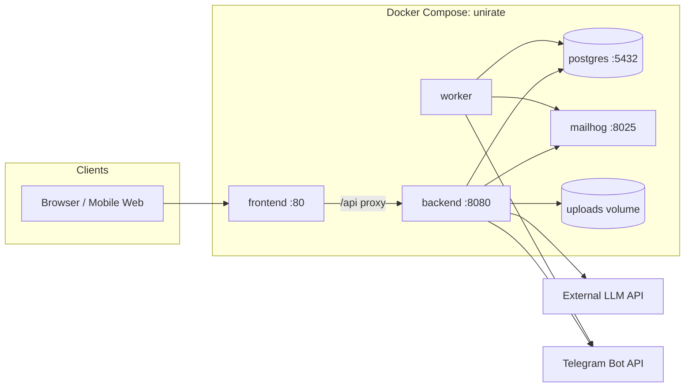
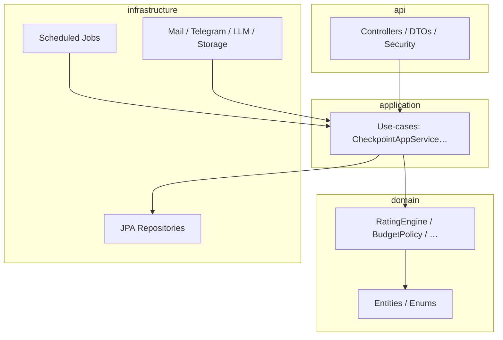

# 06 — Архитектура приложения

**Стек (зафиксирован):** Java 21 · Spring Boot 3.4 · React 18 (Vite + TypeScript) · PostgreSQL 16 · Docker Compose · GitHub Actions.

## Контекстная схема



## Контейнеры

| Сервис | Образ / билд | Порт | Роль |
|--------|----------------|------|------|
| `frontend` | `frontend/Dockerfile` | 80 | React SPA + nginx, proxy `/api` → backend |
| `backend` | `backend/Dockerfile` | 8080 | REST API, auth, файлы |
| `worker` | тот же образ backend | — | `@Scheduled` списание АР, reminders |
| `db` | `postgres:16-alpine` | 5432 | Данные |
| `mailhog` | `mailhog/mailhog` | 8025 UI / 1025 SMTP | Dev-почта |

Запуск: `docker compose up --build`. Миграции Flyway + seed при старте backend.

## Слои backend (`backend/src/main/java/ru/unirate`)



| Пакет | Ответственность |
|-------|-----------------|
| `api` | HTTP, валидация входа, RBAC, маппинг ошибок (русский `message`) |
| `application` | Оркестрация транзакций, вызов domain + infra |
| `domain` | Чистые правила АР/бюджета — **только unit-тесты без Spring** |
| `infrastructure` | JPA, SMTP, TG, LLM client, filesystem uploads |

## Frontend

```
frontend/src/
  app/          # router, providers
  pages/        # экраны по ролям (W1–W11)
  features/     # auth, checkpoints, activities, feed…
  shared/       # ui kit, api client, types
```

API-клиент бьёт в `/api/v1/*` (nginx proxy в Docker; Vite proxy в dev).

## Фоновые процессы (worker)

| Job | Период | Spec |
|-----|--------|------|
| `ArDeductionJob` | `arDeductIntervalSec` | 03-rating-rules |
| `DeadlineReminderJob` | 5 мин | 12, 15 |
| `PollEndedJob` | 1 мин | 11, 12 |

## Безопасность

- BCrypt пароли; JWT access (гипотеза зафиксирована: **JWT**).
- `@PreAuthorize` / SecurityFilterChain по ролям: `STUDENT`, `TEACHER`, `ADMIN`.
- Uploads: max 10 MB; pdf, zip, doc, docx, png.
- LLM ключ только в env.

## Наблюдаемость

- `GET /api/v1/health` → `{ "status": "UP" }`
- Actuator health для CI/compose healthcheck
- Лог каждого тика списания АР на уровне INFO

## Связанные документы

- БД: [18-database.md](18-database.md)
- Сценарии: [19-user-flows.md](19-user-flows.md)
- API: [05-api.md](05-api.md)
