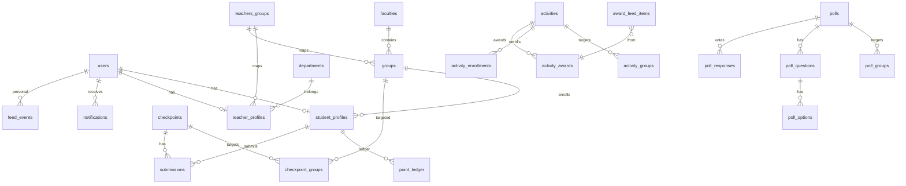

# 18 — Архитектура БД

СУБД: **PostgreSQL 16**. Миграции: Flyway (`backend/src/main/resources/db/migration`).

## ER-диаграмма (ядро)

## Таблицы (кратко)

| Таблица | Назначение |
|--------|------------|
| `users` | email, password_hash, role, email_verified, full_name |
| `faculties` / `groups` / `departments` | справочники |
| `student_profiles` | user_id, group_id, membership_status, is_group_lead, academic_rating |
| `teacher_profiles` | user_id, department_id |
| `teacher_group_links` | teacher ↔ group (+ бюджет считается по ledger) |
| `checkpoints` | title, description, deadline, cost, created_by |
| `checkpoint_groups` | M2M |
| `submissions` | checkpoint_id, student_id, status, url, file_path, ar_debited |
| `activities` | type, max_points, event_date, created_by |
| `activity_groups` / `activity_enrollments` / `activity_awards` | |
| `point_ledger` | student_id, currency, amount (+/−), reason, ref_type, ref_id, actor_id |
| `budget_spends` | teacher_id, group_id, year_month, amount (денорм. для быстрых проверок) |
| `polls` / `poll_questions` / `poll_options` / `poll_groups` / `poll_responses` | |
| `award_feed_items` | публичная лента наград |
| `feed_events` | персональная лента |
| `notifications` | in-app |
| `notification_settings` | email/tg флаги |
| `app_settings` | key-value |
| `semesters` | name, dates, activated_at |
| `email_verification_tokens` | |

## Индексы (важные)

- `users(email)` UNIQUE  
- `submissions(checkpoint_id, student_profile_id)` UNIQUE  
- `point_ledger(student_profile_id, created_at DESC)`  
- `award_feed_items(created_at DESC)`  
- `feed_events(user_id, created_at DESC)`  
- `budget_spends(teacher_id, group_id, year_month)` UNIQUE  
- `submissions(status, checkpoint_id)` для джобы списания  

## Ограничения

- `academic_rating` CHECK (0 … 1000)
- `activity_awards.level` CHECK IN (25,50,75,100)
- `point_ledger.currency` IN (`AR`,`BUA`,`BOA`)
- `submissions.ar_debited` ≥ 0 и ≤ checkpoint.cost (приложение + частичный CHECK)

Полный DDL: `backend/src/main/resources/db/migration/V1__init.sql`  
Seed: `V2__seed.sql`
