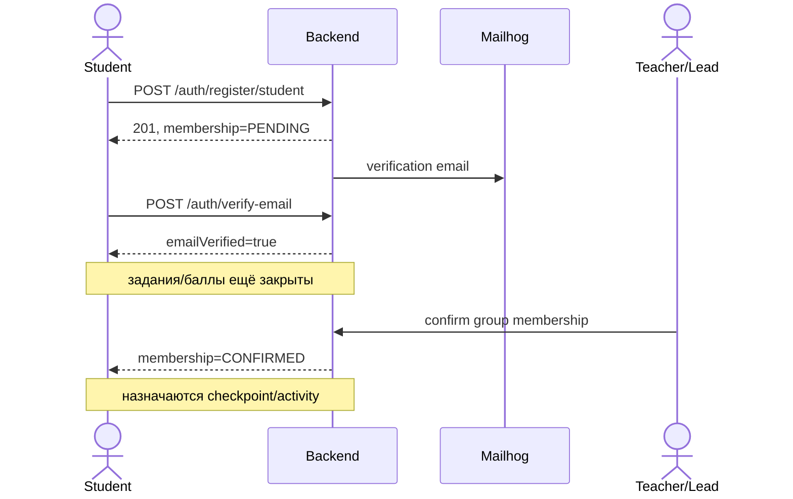
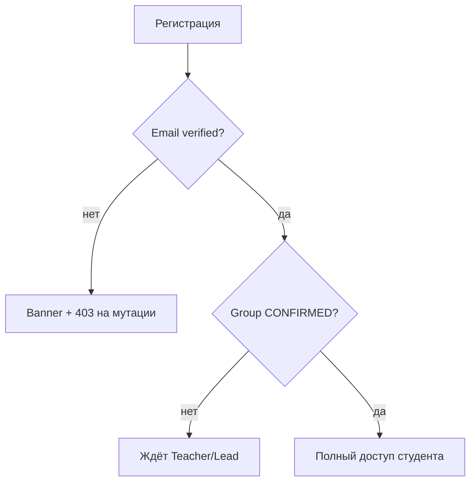
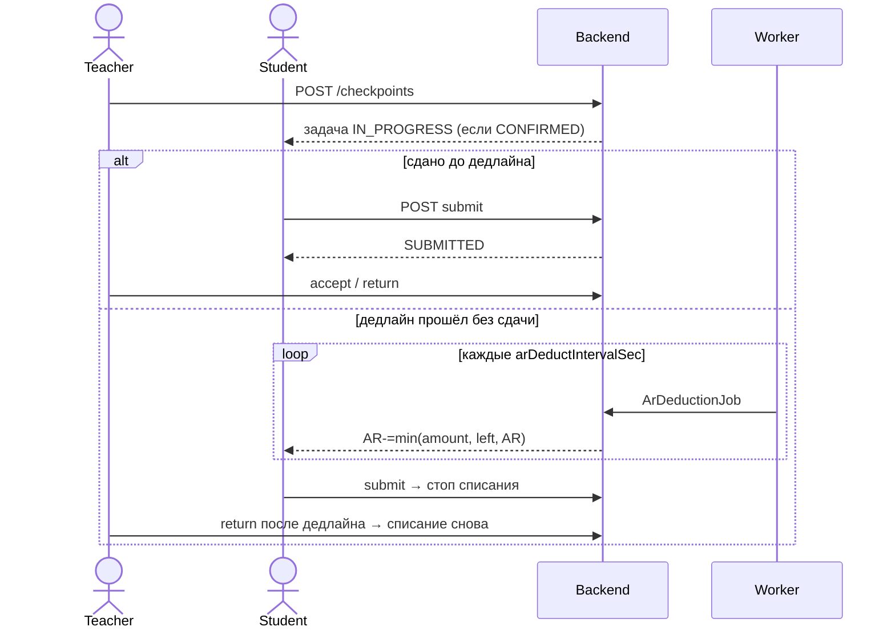
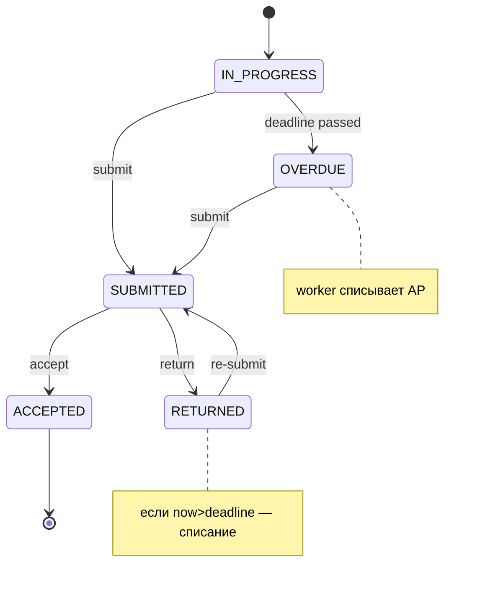
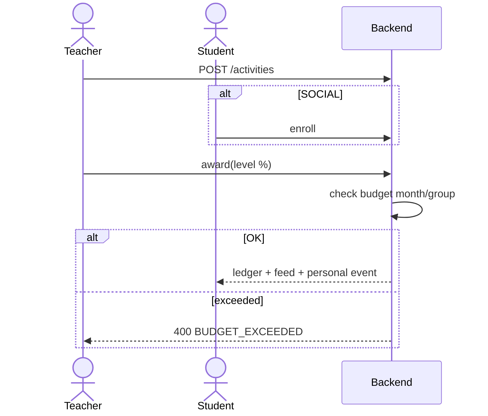
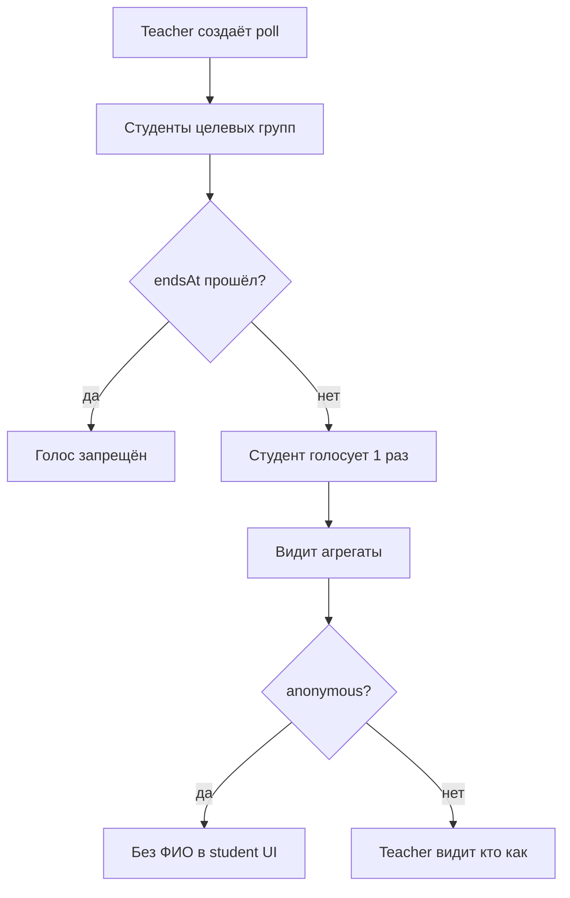
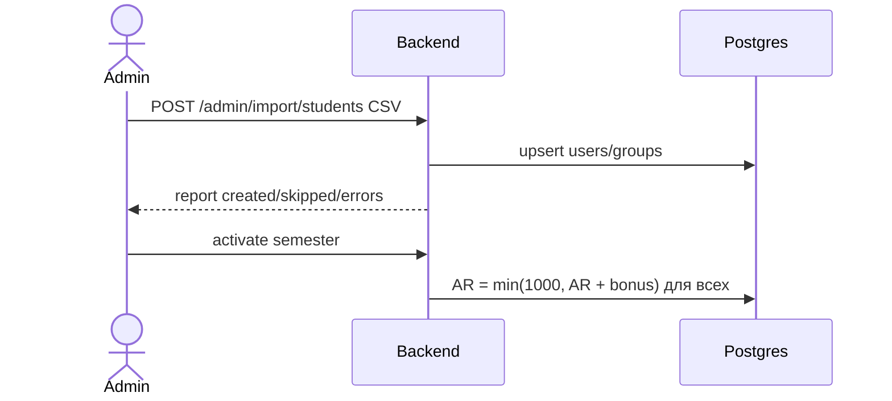
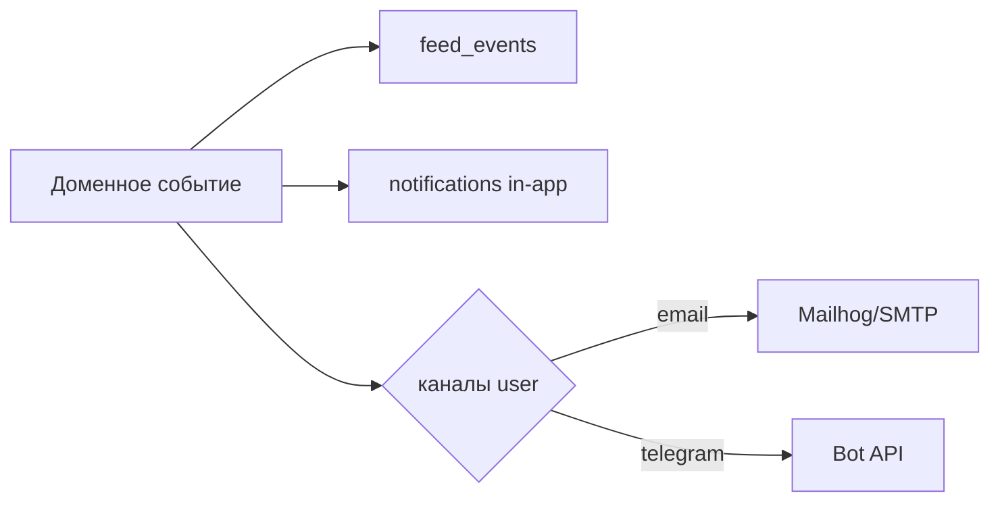

# 19 — Пользовательские сценарии и потоки

Связь с UI: [07-ui-flows.md](07-ui-flows.md). E2E: `docs/qa/e2e-scenarios.md`.

---

## UC-01 Регистрация и допуск студента

**Акторы:** Student, Teacher/GroupLead, система (email).

---

## UC-02 Контрольная точка и списание АР

**Акторы:** Teacher, Student, Worker.

---

## UC-03 Активность и бюджет

---

## UC-04 Опрос

---

## UC-05 Админ: импорт и семестр

---

## UC-06 Уведомления и персональная лента

---

## Матрица ролей × сценарии

| Сценарий | Student | Teacher | Admin | Worker |
|----------|:-------:|:-------:|:-----:|:------:|
| UC-01 регистрация | ● | confirm | | |
| UC-02 АР | submit | CRUD/review | settings | deduct |
| UC-03 баллы | enroll | create/award | | |
| UC-04 опрос | vote | create | | poll-end |
| UC-05 админ | | | ● | |
| UC-06 нотификации | read | read | | remind |
| Лента наград | read | read | | |
| Аналитика | | ● | | |
| ИИ-черновик | tips | draft/summary | | |
